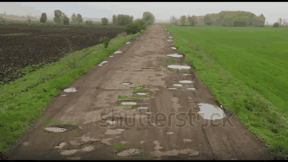
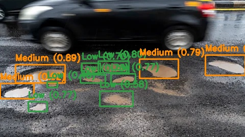
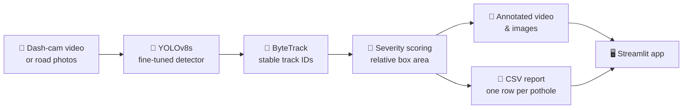
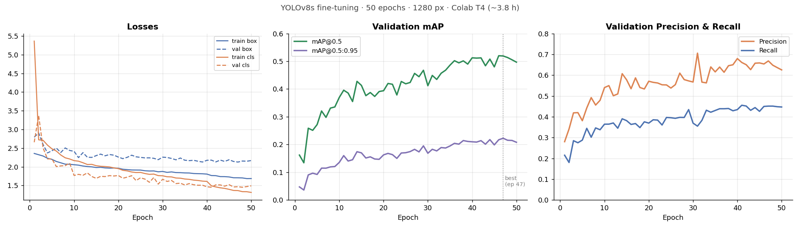
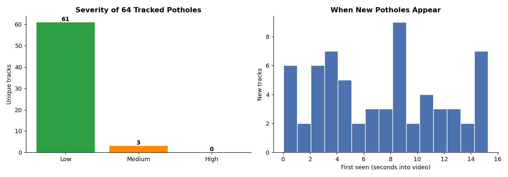

# 🛣️ RoadGuard AI — Pothole Detection, Tracking & Road Damage Reporting


<p align="center">
  
</p>
<p align="center"><sub>Pothole tracking on road footage: each box keeps its track ID across frames and is colored by severity.</sub></p>

An end-to-end computer vision system that turns ordinary dash-cam footage into a **road-maintenance report**: a fine-tuned **YOLOv8s** detects potholes, **ByteTrack** follows each one across frames so it's counted once, a severity heuristic ranks repair priority, and a **Streamlit web app** lets a non-technical user upload images or video and download a CSV report.

<p align="center">
  
</p>
<p align="center"><sub>Detections colored by severity: 🟢 Low · 🟠 Medium · 🔴 High</sub></p>

## 📌 The Problem

Potholes damage vehicles, cause accidents, and get worse the longer they go unrepaired. In cities like **Karachi**, where monsoon flooding regularly breaks up road surfaces, road inspection is still mostly manual and reactive: authorities often learn about a pothole only after a complaint, a damage claim or an accident.

**Goal:** point an ordinary dash-cam at the road and automatically get back *where* the potholes are, *how severe* each one looks, and a report a maintenance team can act on.

## 🔄 System Pipeline



| Stage | What it does | Why it matters |
|-------|--------------|----------------|
| **Detection** | YOLOv8s fine-tuned from COCO weights on ~7K pothole images | "Pothole" isn't a COCO class, so a stock model detects nothing |
| **Tracking** | ByteTrack assigns a persistent ID to each pothole across frames | A pothole visible for 3 s appears in ~90 frames; tracking counts it **once** |
| **Severity** | Classifies each detection by the share of the frame its box covers | An explainable repair-priority signal without depth sensors or LiDAR |
| **Reporting** | Exports annotated media and a CSV with one row per unique pothole | Output a maintenance team can actually use |
| **Web app** | Streamlit UI for image and video upload, running on a laptop CPU | Usable without any ML knowledge |

## 🗂️ Dataset

An open, multi-source pothole dataset (assembled by [LearnOpenCV](https://learnopencv.com/)) combining Roboflow pothole data, a published research dataset, annotated YouTube dash-cam frames and **RDD2022** road-damage images, in YOLO format.

| Attribute | Value |
|-----------|-------|
| Training images | 6,962 |
| Validation images | 271 |
| Classes | 1 (`pothole`) |
| Key challenge | **Small objects:** most potholes cover a small fraction of a dash-cam frame |

## 🧠 Model & Training

| Setting | Value | Reason |
|---------|-------|--------|
| Base model | **YOLOv8s** (COCO-pretrained) | A stronger feature pyramid than Nano for multi-scale detection |
| Image size | **1280 px** | Small, distant potholes need high resolution to stay visible |
| Epochs | 50 (early-stopping patience 15) | Best weights from **epoch 47** |
| Batch size | 5 | The largest that fits a T4 at 1280 px |
| Augmentation | Mosaic, scale 0.75, **copy-paste 0.3** | Copy-paste adds more small objects per image |
| Hardware | Google Colab, NVIDIA **T4** | About **3.8 hours** of training |

<p align="center">
  
</p>

## 📊 Results

Validation set (271 images), best checkpoint:

| Metric | Score |
|--------|-------|
| Precision | **0.668** |
| Recall | 0.451 |
| F1-score | 0.539 |
| **mAP@0.50** | **0.519** |
| mAP@0.50:0.95 | 0.223 |

**What the numbers mean:** when the model flags a pothole it's right about two-thirds of the time, but it finds a bit under half of the labelled potholes. Most misses are **small, distant potholes**, which is the hardest case in this dataset. The large gap between mAP@0.5 and mAP@0.5:0.95 shows that even correct boxes aren't tightly aligned, which is expected for objects with fuzzy, irregular edges like potholes.

### Video tracking demo

On a 15-second, 1080p road video (459 frames), the pipeline tracked **64 unique potholes** and produced a report:

<p align="center">
  
</p>

| Severity | Rule (box area / frame area) | Tracked |
|----------|------------------------------|---------|
| 🟢 Low | < 1.5% | 61 |
| 🟠 Medium | 1.5% – 5% | 3 |
| 🔴 High | > 5% | 0 |

Sample rows from `road_damage_report.csv`:

| track_id | first_seen_frame | confidence | severity | rel_area |
|----------|------------------|------------|----------|----------|
| 14 | 106 | 0.812 | Medium | 0.0251 |
| 13 | 67 | 0.780 | Low | 0.0074 |
| 23 | 146 | 0.760 | Low | 0.0054 |

## 🖥️ Streamlit Web App

The app runs on a **CPU-only laptop**; no GPU is needed for inference.

- **📷 Image Detection:** upload a road photo and get annotated output, severity counts, and downloadable image and CSV.
- **🎥 Video Tracking & Report:** upload a clip and get unique-pothole counts, measured FPS, a severity chart and a downloadable CSV.
- **ℹ️ About:** explains the system, the severity heuristic and its limitations.
- **Sidebar:** an adjustable confidence threshold, to trade false positives against misses.

## 📁 Project Structure

```
road_damage_ai/
├── notebooks/
│   ├── 01_Train_Pothole_Detector.ipynb            # EDA, baseline, fine-tuning, evaluation, error analysis
│   └── 02_Tracking_and_Deployment_Pipeline.ipynb  # Batch inference, ByteTrack, severity, reports, FPS
├── app/
│   ├── streamlit_app.py                           # Web app (image + video tabs)
│   ├── requirements.txt
│   └── weights/pothole_best.pt                    # Fine-tuned YOLOv8s (22 MB)
├── results/                                       # Sample detection image and CSV reports
├── report/Project_Report.docx                     # Written project report
├── assets/                                        # Images used in this README
└── make_demo_gif.py                               # Converts a tracked video into a README GIF
```

## 🚀 Run It

### Web app (local, CPU)

```bash
cd app
python -m venv venv
venv\Scripts\activate            # Windows
# source venv/bin/activate       # macOS / Linux
pip install -r requirements.txt
streamlit run streamlit_app.py
```

Then open `http://localhost:8501`.

### Training & pipeline notebooks (Colab, GPU)

Open the notebooks in [Google Colab](https://colab.research.google.com) with a **T4 GPU** runtime. Notebook 1 downloads the dataset automatically and saves checkpoints to Google Drive, so training survives disconnects.

## ⚠️ Limitations

- **Recall is the main weakness** (0.45): small, distant potholes are often missed.
- **Severity is a proxy.** Box area reflects both pothole size *and* distance from the camera, so a nearby small pothole can rank above a distant large one.
- **Tracking can split IDs.** On a road full of similar-looking potholes, a track can be lost and restarted with a new ID, which inflates the unique count.
- **No GPS:** report rows reference video frames, not map locations.

## 🔮 Future Work

- Fuse detections with **GPS** so every report row has a map location
- Train a severity regressor on human-rated labels instead of using box area
- Expand to **multi-class road damage** (cracks, raveling, faded markings) with RDD2022
- Export to **ONNX / TFLite** for a Raspberry Pi mounted behind the windshield
- Use SAHI tiled inference to improve small-object recall

## 🛠️ Tech Stack

Python · PyTorch · Ultralytics YOLOv8 · ByteTrack · OpenCV · Streamlit · pandas · Google Colab

## 📜 License & Credits

Ultralytics YOLOv8 is licensed under **AGPL-3.0**. Dataset assembled by LearnOpenCV from Roboflow, a published pothole research dataset, YouTube dash-cam frames and RDD2022.

## 👤 Author

**Muhammad Mujtaba Khan Suri** — CS @ UBIT, University of Karachi
[GitHub](https://github.com/MMujtabaX)
